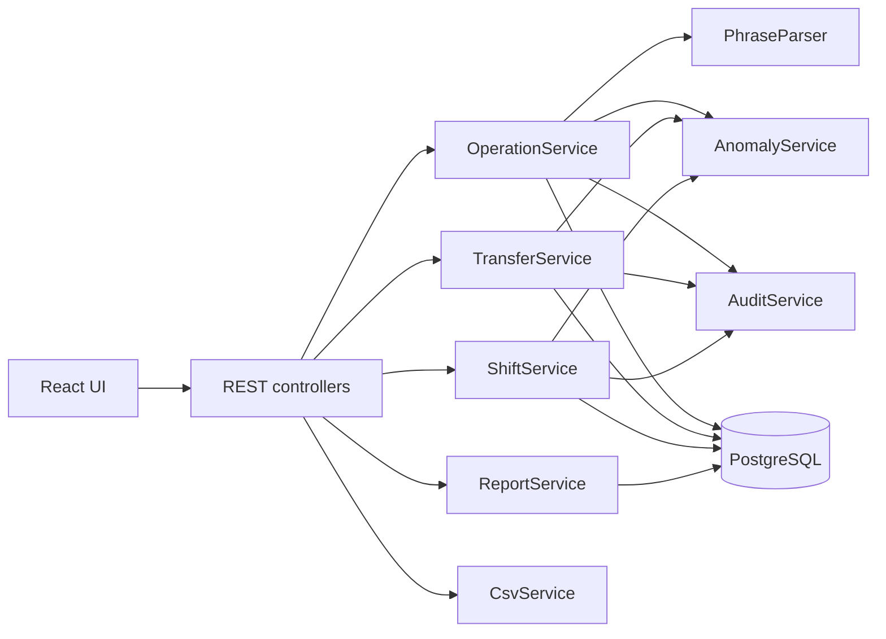

# FinTrack

A service company with offices in Vienna, Munich and Prague handles money in four currencies, in bank accounts and cash boxes. Typical problems: an amount is "fixed" by overwriting it and nobody knows what it was, money sent between offices is counted twice or lost, cash boxes do not match at the end of the day. FinTrack records every movement so that the balance is always explainable.

**Live demo:** https://boris-plotnikov.click/fintrack/ - sign in with one click as owner, manager or employee. Data resets every night.


Demonstration project for the fictional company "Alpine Services GmbH". The business rules come from a real accounting system I built for a client; all data here is invented.

## Quick tour

1. Sign in as **Lena (employee, Vienna)**. Type `Paid 35 EUR for taxi from Cash Vienna` in quick entry → check the card → save.
2. Correct the amount: the original stays, a linked correction appears.
3. Open **Shift**, open and close it: type the counted cash without seeing the expected amount.
4. Sign in as **Markus (manager)**: confirm the money in transit on **Transfers**, review **Anomalies**.
5. Sign in as **Anna (owner)**: **Dashboard** and **Reports** with CSV export and bank statement import.
6. Press **`</> Under the hood`** (bottom right, on every screen, also before sign-in): each feature as a chain of real code, controller → service → repository → SQL → test, plus a live list of the API calls the page makes. The guided tour has a “See the code” link on every step.

The snippets are cut from the source at build time by `frontend/scripts/codetour.mjs` using `frontend/codetour.json`; the build fails if a referenced method disappears.

## Business rules

| Rule | Why |
|---|---|
| Operations are never edited or deleted - a change is a new CORRECTION linked to the original | Full history for the audit; nobody can hide a change |
| Balance = opening balance + sum of operations, never stored | Cannot drift out of sync |
| Exchange rate is fixed at the moment of the operation | A later rate change does not rewrite the past |
| A cash box cannot go below zero; a bank account can (overdraft → anomaly) | Physical cash cannot be negative |
| Transfer = TRANSFER_OUT at once, TRANSFER_IN only after the receiver confirms | Money "in transit" is visible, never double |
| Blind shift close: expected amount hidden; difference above tolerance needs a comment | People count instead of confirming |
| Large amount, late correction (24 h+), large correction, cash difference, overdraft → anomaly | The owner sees exceptions, not every row |
| Employees use only accounts of their office; reports, audit, import - management only | Least privilege, checked in the API |
| A correction counts in the month it is made | A closed month never changes |

## Architecture



Decisions: [docs/adr](docs/adr). Requirements: [docs/requirements.md](docs/requirements.md).

## Tech stack

Java 21 · Spring Boot 3.5 (Web, Data JPA, Security, Validation, Scheduling) · PostgreSQL 16 · Flyway · JUnit 5 · H2 · React + TypeScript (Vite, Tailwind, Recharts) · Docker · GitHub Actions

The frontend was built by an external developer to my specification ([docs/frontend-brief.md](docs/frontend-brief.md)) and under my review.

## Run locally

```bash
cp .env.example .env
cd frontend && npm install && npm run build && cd ..
cd backend && mvn spring-boot:run      # creates demo data on the first start
```

Open http://localhost:8102 - API docs at `/swagger-ui.html`.

## Tests

```bash
cd backend && mvn test
```

19 tests: phrase parser (European number formats, account guessing), money rounding, and business rules on the demo company - cash cannot go negative, office access, category kind, corrections and cancellation, author-only corrections, anomalies, transfer in transit / confirm / reject / currency conversion, blind shift close with tolerance, monthly report, CSV import with dry run and duplicate check.

## About

Built by Boris Plotnikov as a portfolio project. The company, people and amounts are fictional.

AI tools were used to review code and speed up routine work. The design, the business rules and the tests are my own, and I can explain every part of the code.
